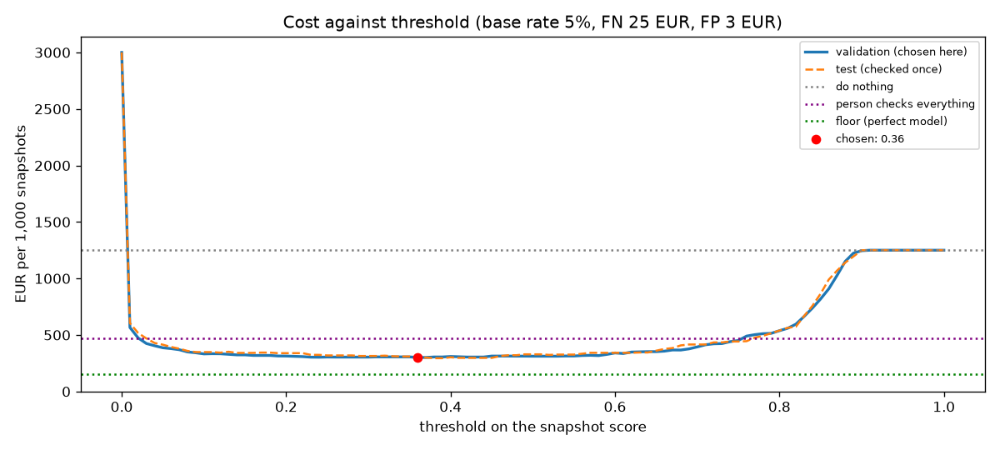

# Assignment 2 Report

- **Name**: Alejandra Gómez Vallejo
- **Student ID**: 19766
- **Email**: agomez.ieu2022@student.ie.edu
- **Group**: BBADBA 5B

**Dataset:** Roboflow Universe, workspace `joseph-nelson`, project `hard-hat-workers`, **version 5** —
https://universe.roboflow.com/joseph-nelson/hard-hat-workers/dataset/5

## Business problem, and the cost of being wrong

**Scenario**
I am the safety team of a large construction site (a residential building or a warehouse) with **20 fixed cameras**, one per
work zone. In Spain every site has a *recurso preventivo*, the person in charge of checking that safety rules are followed. Today
that person looks at the cameras now and then, and if someone is not wearing a hard hat, they call or walk over to the zone
supervisor (*encargado*) so the worker puts it on.

The model looks at every snapshot of every camera and answers one question: **is there at least one person without a hard hat in
this image?** If yes, the zone supervisor gets an alert and walks over to check. In the three-way design (section "What a person
still has to check"), doubtful snapshots go first to the *recurso preventivo*, who looks at the image on a screen.

**Unit of decision: one snapshot.** Each camera takes a snapshot every 10 minutes during a 10-hour working day:
20 × 6 × 10 = **1,200 snapshots a day**. 10 minutes because it leaves time for the supervisor to react before the next one, and
because a violation that lasts less than that is not something anyone can act on anyway. What triggers an action is the image,
not each head, so even though the model detects boxes, the decision is one per image.

**Positive class: `head`** (a head without a hard hat). An image is positive if it has at least one `head`.

**Why the two errors do not cost the same**
- **False negative** (someone without a helmet, no alert): that person keeps working unprotected until the next snapshot. The cost
  is the risk of a head injury and of a fine from the Labour Inspectorate. In occupational safety a *falta grave* goes from
  **€2,451 to €49,180** (LISOS, amounts updated by Ley 10/2021).
- **False positive** (alert, but everyone had a helmet): the supervisor loses a few minutes walking over. It is annoying, and if
  it happens a lot people stop trusting the alerts, but each one costs a few euros.

So a missed violation costs about **8 times** a false alarm (€25 vs €3, justified in the cost section).

**How this framing drives the rest of the pipeline** (not just narrated):

| Framing decision | What it changed later |
|---|---|
| The unit is one snapshot | I turn boxes into one score per image (the most confident `head`), and the cost, the confusion matrix and the review load are all counted in snapshots |
| The positive class is `head` | My headline number is `head` AP50 and recall, not the mean mAP, which `helmet` pulls up |
| A FN costs ~8× a FP | The threshold is chosen by **minimum expected cost**, not by F1 or accuracy, which treat both errors as equal |
| On a real site almost everyone wears a helmet | I re-weight everything to a **5% base rate** instead of the dataset's ~19%, and I do not quote precision or accuracy on the dataset's mix |
| Only 1 hour a day of review is available | The two thresholds of the three-way design are chosen **subject to that capacity**, not just the cheapest |
| The decision has to work on new days, not on images I tuned on | I choose every threshold on **validation** and check it once on test, like with the validation season in assignment 1 |

## Dataset

**Hard Hat Workers** by Northeastern University - China, public domain, used as published (no fork):
`joseph-nelson / hard-hat-workers / 5` (`raw_HeadHelmetClasses`), downloaded in YOLO format with the Roboflow API in `train.ipynb`.

- **7,035 images**, split 70/20/10 by Roboflow: **4,916 train, 1,413 valid, 706 test**.
- **2 classes:** `head` (a head without a hard hat) and `helmet` (a head with one). Each image is a photo of people, some on
  construction sites and some in other places, with a box around every head.

**Why this dataset actually serves the problem, and not just looks like it**
- The decision is "is someone without a helmet". The dataset labels exactly that at the level of each head, and it labels heads
  **with** helmets as their own class. So the model has to learn the difference between a helmet and a bare head, not just find
  people. That is the difference between this and a person detector (the COCO baseline shows why it matters).
- **It has real negative images**: 4,005 train, 1,157 valid and 566 test images where everyone wears a helmet. Without negatives
  I could not measure specificity, so I could not count false alarms, and half the assignment (the cost of a FP) would be guessed.
  This is why I discarded most defect datasets, where every image has a defect.

**Why version 5 and not another one**
- v10 also has a `person` class, but the dataset description says it is labelled only in some images. A class that is labelled
  sometimes would count correct detections as false positives and add noise to the metrics.
- v11-v13 are already augmented 3× and resized to 416 px. I wanted the original images at 640, because heads are small
  (see below), and Ultralytics already does its own augmentation while training.
- v14 merges `helmet` into `head`, which removes exactly the distinction I need.

## What the dataset's composition implies

All of this is computed from the label files in `train.ipynb` (not copied from the Universe page). Sanity checks: the splits match
Universe (4,916 / 1,413 / 706), every coordinate is between 0 and 1, there are no duplicated file names, and **no image is
empty**: every image has at least one head.

**Instances per class**

| Class | Train | Valid | Test | Total | Share |
|---|---:|---:|---:|---:|---:|
| `head` (positive) | 4,612 | 1,339 | 726 | 6,677 | 25.3% |
| `helmet` | 13,919 | 3,913 | 1,915 | 19,747 | 74.7% |

**At image level, which is my unit of decision**

| Split | Images | Positive images | Positive rate | Heads / image | Helmets / image |
|---|---:|---:|---:|---:|---:|
| Train | 4,916 | 911 | 18.5% | 0.94 | 2.83 |
| Valid | 1,413 | 256 | 18.1% | 0.95 | 2.77 |
| Test | 706 | 140 | 19.8% | 1.03 | 2.71 |

**What kind of positive image** (a column I added after looking at the images)

| Scene | Train | Valid | Test |
|---|---:|---:|---:|
| Negative: everyone wears a helmet | 4,005 | 1,157 | 566 |
| Positive: **nobody** wears a helmet (crowds, streets, classrooms) | 413 | 116 | 70 |
| Positive: several heads without helmet among people with one | 293 | 82 | 36 |
| Positive: **one** head without helmet among people with one | 205 | 58 | 34 |

**Object size** (side of the box once YOLO rescales the long side to 640 px; COCO calls an object "small" under 32 px)

| Class | Median area of the image | 10th–90th pct area | Median side | Under 32 px | Under 16 px |
|---|---:|---:|---:|---:|---:|
| `head` | 0.60% | 0.22% – 1.96% | 41 px | 27.5% | 0.5% |
| `helmet` | 0.83% | 0.22% – 4.86% | 48 px | 22.7% | 0.9% |

**What I take from it**
- **`helmet` has 3× more instances than `head`.** The mean mAP is pulled up by the common, easier class, so my headline number is
  `head`. An average over the two would hide the class I care about.
- **The `head` numbers are trustworthy overall, but not every sub-group is.** Test has 726 heads in 140 images: with that many,
  recall has a margin of error of about ±2 points. But the hardest group, one head among helmets, has only 34 test images, so
  its recall moves about ±8 points by chance, and I read it as a direction, not a number.
- **The splits are consistent with each other** (18-20% positive images, ~3.7 boxes per image in all three), so validation is a
  fair place to choose thresholds and test is a fair check. That is what a random 70/20/10 split gives.
- **The mix is not a site's.** 19% of the images are positive; on a Spanish site with mandatory helmets I assume 5% (cost section).
  Recall and specificity are properties of the model, but **precision and accuracy depend on the mix**, so I never quote them on
  the dataset's mix: I re-weight to the base rate.
- **Half of the positive test images are not what a site camera sees.** 70 of the 140 positives are scenes where nobody wears a
  helmet: crowds, streets and close-ups, which are easy because the image is full of bare heads. The case a site would actually
  have, one worker without a helmet among colleagues who wear one, is only 34 images. So **the test number will not hold in
  production** as it is; I measure how much it drops in section "Per-class evaluation".
- **No image is empty.** There are no photos of an empty site, a site at night or machinery with nobody around. A real camera will
  produce many of those, and I cannot measure false alarms on them.
- **Heads are small:** a quarter of them are under 32 px at 640 px, and at 416 px (versions 11-13) many would fall under 16 px.
  This is why I trained at 640, and it is where I expected the model to fail.

## Finetuning and baselines

**Model and task.** Object detection with `yolo11n`, finetuned from the COCO weights.
- **Detection and not classification:** the decision depends on small heads (often 30-40 px) in a big scene. A classifier
  resizes the whole image and has to find the bare head without being told where to look; a detector scores each head. It also
  gives me boxes to show the supervisor where the problem is.
- **From the COCO weights, not from scratch:** the backbone already knows edges, textures and the shape of heads and people from
  118,000 photos. What changes is mostly the detection head, which goes from 80 classes to 2. With ~5,000 images, training from
  scratch would be much worse (the card example in class showed the same).
- **`yolo11n` and not `s`:** it trained in about 40 minutes on a free Colab T4, and the dashboard runs it on CPU. The results below
  show that the problem is not capacity on most images, but on small heads among helmets; `yolo11s` is the next thing I would try.

**Settings.** 30 epochs, `imgsz=640`, `batch=16`, `seed=0`, Ultralytics' default augmentation (mosaic, flips, colour jitter) and
optimizer. 30 epochs because there are small objects and more images than in the class example (15). **Where:** Google Colab,
T4 GPU, with the same code as `train.ipynb`. The committed weights are `weights/hardhat_yolo11n.pt`. To check that the
repo pipeline reproduces the Colab run, I also ran `REUSE_WEIGHTS=1 uv run python main.py train` on my MacBook Air (everything
except the training step, on the committed weights): snapshot scores matched the Colab ones to within 0.001 and the chosen
thresholds were identical. The artifacts in the repo come from that run. `uv run python main.py train` without the flag trains
from scratch. Ultralytics keeps the
checkpoint with the best validation fitness, so validation is already "used" for that choice and **every final number is on test**.

**Training curves:** the three training losses (box, cls, dfl) and the three validation losses went down together for the 30
epochs, and validation mAP50-95 was still going up at the end (0.58 → 0.675). No sign of overfitting: if anything, 30 epochs
was a bit short.

**Baselines on the same test split**
1. **Trivial:** predict nothing (every snapshot passes). Since 81% of the training images are negative, "majority class" is the
   same thing.
2. **COCO `yolo11n` zero-shot.** COCO has 80 classes and **neither `head` nor `helmet`**. The class list is part of the
   architecture (it is the number of output channels of the detection head), so at box level its AP for my classes is 0 by
   construction. The closest class it has is `person`, so at image level I used "alert if there is a person", scored by the most
   confident person box.

**Box level (test)**

| Model | mAP50 | mAP50-95 | `head` AP50 | `head` recall |
|---|---:|---:|---:|---:|
| Predict nothing | 0 | 0 | 0 | 0 |
| COCO `yolo11n` zero-shot (no head/helmet class) | 0 | 0 | 0 | 0 |
| **`yolo11n` finetuned** | **0.975** | **0.681** | **0.967** | **0.930** |

**Image level (test, 140 positive / 566 negative)**

| Model | Threshold | Recall | Specificity | Accuracy | AUC |
|---|---:|---:|---:|---:|---:|
| Predict nothing / majority class | – | 0.000 | 1.000 | 0.802 | – |
| COCO zero-shot ("alert if a person") | 0.25 | 1.000 | 0.025 | 0.218 | 0.677 |
| **`yolo11n` finetuned** (chosen operating point) | **0.36** | **0.914** | **0.981** | **0.967** | **0.969** |

**What changed, and was the gap as large as I expected?**
- **Predicting nothing has 80% accuracy and catches nothing.** That is why I never use accuracy to choose anything here.
- **The COCO person detector alerts on 552 of the 566 safe images** (specificity 2.5%), because there are people in every image.
  Its AUC of 0.68 means its person confidence ranks images only a bit better than chance. This was the point of the baseline:
  **finding people is not the problem, telling helmets apart is**, and that needs finetuning.
- The finetuned model beats both clearly. The gap was larger than I expected at box level (0.97 head AP50), and I did not expect
  the image-level AUC to be 0.97. But the next section shows that a good part of it comes from the easy images.

## Per-class evaluation and failure modes

**Per class, test** (precision and recall at Ultralytics' best-F1 confidence; AP over all confidences)

| Class | Images | Instances | Precision | Recall | AP50 | AP50-95 |
|---|---:|---:|---:|---:|---:|---:|
| **`head` (positive)** | 140 | 726 | 0.941 | 0.930 | 0.967 | 0.675 |
| `helmet` | 636 | 1,915 | 0.956 | 0.943 | 0.982 | 0.687 |
| all (mean) | 776 | 2,641 | 0.948 | 0.936 | 0.975 | 0.681 |

**Which class carries the headline number:** `helmet`. It has 2.6× more instances and the higher AP50 (0.982 vs 0.967), so the
mean (0.975) looks better than the class I care about. **My number is `head`: AP50 0.967, recall 0.930.** The gap between AP50
and AP50-95 (0.97 vs 0.68) says the boxes are not tight, but for this decision I only need to find the head, not its exact
outline, so AP50 is the one that matters.

**Box confusion matrix, test, conf 0.25** (rows = predicted, columns = true)

|  | true `head` | true `helmet` | true background |
|---|---:|---:|---:|
| **pred `head`** | **688** | 4 | 69 |
| **pred `helmet`** | 13 | 1,842 | 144 |
| **pred background** | 25 | 69 | – |

Of the 726 heads without a helmet, the model found 688. Of the 38 it got wrong, **25 it did not see at all** (background) and
**13 it saw but called `helmet`**. In the other direction, it drew 69 `head` boxes where there was nothing labelled. Confusing
helmet → head almost never happens (4).

**Where it breaks**

*Head recall by size* (each true head matched to a predicted head at conf ≥ 0.25 and IoU ≥ 0.5):

| Head size at 640 px | Heads | Recall |
|---|---:|---:|
| 16–32 px | 176 | 0.892 |
| 32–64 px | 436 | 0.968 |
| > 64 px | 114 | 0.965 |

Small heads, which on a site are workers far from the camera, are missed about 3× as often (11% vs 3%).

*Image recall by type of scene, at the chosen threshold 0.36* (this is the one that matters for a site):

| Positive scene (test) | Images | Caught | Missed |
|---|---:|---:|---:|
| Nobody wears a helmet | 70 | **100%** | 0% |
| Several heads without helmet among helmets | 36 | 97.2% | 2.8% |
| **One head without helmet among helmets** | 34 | **67.6%** | **32.4%** |

**All 12 positive images the model missed at image level are scenes with people wearing helmets around**, and 11 of them are the
single-head case. Validation shows the same (75.9% caught for one head among helmets, 99.1% when nobody wears one). This is the
failure that matters: the typical violation on a site is exactly one worker who took the helmet off while everyone around has it,
and that is where the model is weakest. The headline 91% image recall is helped by 70 easy crowd images.

My reading of why: in a crowd without helmets the image has many bare heads, so the most confident one is almost always very
confident. One bare head among helmets is often small, partly hidden, or wearing something that is in between, and that is also
where the 13 head → helmet confusions are.

**Looking at the images changed my reading of the errors** (`artifacts/failures_missed.png` and `failures_false_alarms.png`):
- **Most of the confident "false alarms" are label errors, not model errors.** Of the 8 safe images with the highest score, at
  least 5 show a person clearly without a hard hat that the dataset did not label: a man in a suit next to two workers, people in
  shirts reading a document on site, a politician speaking in front of workers with helmets. The model is right and the label is
  wrong. So the measured specificity (98.1%) is a **lower bound**: the real false-alarm rate is lower, and so is the cost. The
  other 3 are tiny or partly hidden heads where I cannot tell either.
- **Some "misses" are not real violations.** Among the 8 lowest-scored positives there is a driver inside an excavator cab, an
  injured worker lying on a stretcher, and a man wearing a wide hat that is not a hard hat (labelled `head`). The first two would
  not need a helmet in practice; the third is a genuine miss (a hat that looks like a helmet). The rest are bare heads behind or
  between workers with helmets, which is the real weak point.
- Every metric here measures **agreement with the labels**, not with reality. A table cannot tell "the model is wrong" from "the
  label is wrong", and only the first one is fixed by a better model. Label noise in train (unlabelled bare heads taught as
  background) probably also costs some recall.

## Cost matrix and operating point

**Costs per snapshot**

| | Someone without helmet (real) | Everyone with helmet (real) |
|---|---|---|
| **Alert** | **TP = €3** | **FP = €3** |
| **No alert** | **FN = €25** | **TN = €0** |

- **TP = FP = €3.** Checking costs the same whether there was a violation or not: about 5 minutes of the supervisor
  (~€30/hour including social security, so €2.5) plus interrupting the crew for a moment (~€0.5). What differs between a TP and
  a FP is not what the walk costs, but what it prevents. The TP has a cost, and that matters: even a perfect model costs
  5% × €3 = **€150 per 1,000 snapshots**, the walks that do need to happen. That is the floor.
- **FN = €25.** The expected cost of leaving one person without a helmet for 10 more minutes. I built it from two channels:
  - *Fine:* if about 0.4% of these episodes end with an Inspectorate report at the minimum *grave* amount, 0.004 × €2,451 ≈ **€10**.
  - *Injury:* if 1 in 2,000 episodes ends in a head injury with sick leave, and that costs the company about €30,000 (days off,
    replacement, stopped work, and the 30-50% surcharge on benefits that applies when a safety measure was missing),
    €30,000 / 2,000 ≈ **€15**.
  - Both probabilities are my assumptions, not data. That is why I swept the FN cost below and looked for where the answer changes.
- **TN = €0**: nothing happens.

The ratio matters more than the numbers: **one missed violation costs as much as ~8 false alarms**. It is a clear asymmetry but
much less extreme than in the bottle example in class (125×), so I expected a moderate threshold, not "alert at the slightest doubt".

**Base rate: 5%** of snapshots have someone without a helmet. I cannot take it from the dataset, because there the share of
positives (19%) was decided by whoever collected the images, not by a site. Inspection campaigns on 161 residential sites in
Saskatchewan (2015) found that **fewer than half** of the workers wore hard hats, but that is without enforcement. On a Spanish
site with a *recurso preventivo* and helmets mandatory, I assume 5%: someone who takes it off for a moment to talk, to drink or
because of the heat. It is my weakest assumption, so I swept it too.

**The sweep.** I swept the threshold from 0 to 1 in steps of 0.01 on **validation**, computed the expected cost per 1,000
snapshots at each one, and took the minimum. The zone rates are measured separately on positive and negative images (they belong
to the model) and re-weighted with the 5% base rate:
`cost = p · [FN · missed + TP · caught] + (1 − p) · [FP · false alarms]`. The same function (`costs.py`) is used by the dashboard.

| Threshold | Recall | Specificity | FN / 1,000 | FP / 1,000 | € / 1,000 |
|---:|---:|---:|---:|---:|---:|
| 0.05 | 0.957 | 0.933 | 2.1 | 63.2 | 386.9 |
| 0.10 | 0.957 | 0.952 | 2.1 | 45.2 | 332.7 |
| 0.20 | 0.945 | 0.964 | 2.7 | 34.5 | 313.6 |
| 0.30 | 0.934 | 0.971 | 3.3 | 27.1 | 304.3 |
| **0.36** | **0.930** | **0.974** | **3.5** | **24.6** | **301.2** |
| 0.50 | 0.906 | 0.979 | 4.7 | 19.7 | 312.2 |
| 0.70 | 0.805 | 0.990 | 9.8 | 9.9 | 394.4 |
| 0.90 | 0.004 | 1.000 | 49.8 | 0.0 | 1,245.7 |

**Operating point for the model alone: 0.36** (€301 per 1,000 snapshots on validation). Checked once on test: **€299.7 per 1,000**,
recall 0.914, specificity 0.981 (128 caught, 12 missed, 11 false alarms, 555 correct passes). The best possible threshold on test
would have been 0.38 at €294.6, so not cheating cost me €5 per 1,000: the threshold generalises.

The curve is **flat between about 0.2 and 0.5** (€301-314), so the exact third decimal does not matter; what matters is staying
away from the two cliffs: below 0.1 false alarms explode, above 0.7 misses explode. Here F1 and accuracy on the validation set also
pick 0.36, but that is a coincidence of this dataset's mix: change the costs or the base rate (tables below) and the cost-optimal
threshold moves while F1's stays where it is, because F1 assumes a FP and a FN cost the same.

**Base rate and precision.** At the 0.36 threshold, recall and specificity stay the same, but:

| Base rate | Alert precision | False alarms per real one | Accuracy | Accuracy of "never alert" |
|---:|---:|---:|---:|---:|
| 18.1% (dataset) | 88.8% | 0.13 | 96.6% | 81.9% |
| 5% (my site) | 65.4% | 0.53 | 97.2% | 95.0% |
| 1% | 26.6% | 2.76 | 97.4% | 99.0% |

At 5%, one alert in three is a false alarm, even with the same model. On the dataset's mix it looked like one in nine. If I had
quoted the dataset's precision to a site manager, the supervisors would find out in the first week.

**The assumption that would most change my answer: the FN cost.**

| FN cost | Best threshold | Recall | Model alone € / 1,000 | Do nothing € / 1,000 | Person checks all € / 1,000 |
|---:|---:|---:|---:|---:|---:|
| €3 | 0.89 | 0.02 | 150.0 | 150.0 | 357.0 |
| €5 | 0.80 | 0.66 | 194.2 | 250.0 | 367.0 |
| €10 | 0.58 | 0.90 | 238.6 | 500.0 | 392.0 |
| **€25** | **0.36–0.37 (tie)** | **0.93** | **301.2** | **1,250.0** | **467.0** |
| €50 | 0.23 | 0.95 | 372.1 | 2,500.0 | 592.0 |
| €100 | 0.10 | 0.96 | 493.9 | 5,000.0 | 842.0 |

I assumed €25 because of the fine and injury channels above. **The threshold moves from 0.36 to 0.58 if the FN is worth €10, and
to 0.10 if it is worth €100.** The decision to use the model at all is robust: it beats doing nothing as soon as a missed
violation costs more than the walk (≥ €4), and it beats a person checking everything at every FN cost I tried. The base rate
moves the threshold the same way: 0.68 at 1%, 0.58 at 2%, 0.36 at 5%, 0.23 at 10%, 0.10 at 20%. So if a pilot measures a base
rate clearly different from 5%, the threshold has to be re-chosen; the dashboard has both as sliders.

## What a person still has to check

**Three outputs, two thresholds:** score < `low` → pass; `low` ≤ score < `high` → the *recurso preventivo* looks at the snapshot on
a screen; score ≥ `high` → direct alert to the supervisor.

The person is **not an oracle but a second classifier with a price**:

| | Value | Why |
|---|---|---|
| Time per snapshot | 20 s | finding small heads in a crowded image; not a glance |
| Cost per review | €0.15 | a safety technician at ~€27/hour: 27 × 20 / 3,600 |
| Reviewer recall | 90% | far-away heads are hard for a person too, more so when tired |
| Reviewer specificity | 98% | sometimes a cap or light hair looks like a helmet, and the other way round |
| Review time available | **1 hour a day** | the *recurso preventivo* has other tasks; one hour of screen is realistic |

One hour at 20 s per image is 180 reviews a day, **15% of the 1,200 snapshots**. I searched every pair (`low`, `high`) on a grid of
0.02 on validation and kept the cheapest one that fits in that hour.

**Chosen band: `low` = 0.10, `high` = 0.68.** It was also the cheapest with unlimited review, so the capacity limit did not bind.

**The four designs** (thresholds chosen on validation; test shown, validation in brackets)

| Design | € / 1,000 snapshots | € / day | Missed / 1,000 | False alarms / 1,000 | Recall | Reviews / day | Review time / day |
|---|---:|---:|---:|---:|---:|---:|---:|
| A. Do nothing | 1,250.0 (1,250.0) | 1,500 | 50.0 | 0.0 | 0% | 0 | 0 |
| B. A person checks every snapshot | 467.0 (467.0) | 560 | 5.0 | 19.0 | 90.0% | 1,200 | 6.7 h (0.83 people) |
| C. Model alone (0.36) | 299.7 (301.2) | 360 | 4.3 | 18.5 | 91.4% | 0 | 0 |
| **D. Model + review [0.10, 0.68)** | **268.1 (251.2)** | **322** | **3.6** | **10.8** | **92.8%** | **51** | **17 min** |

**Is it realistic?** Yes. D sends **4.3% of snapshots to review: about 51 a day, 17 minutes**, well inside the hour available, and it
needs no extra hire. Checking everything (B) would need 6.7 hours of screen a day, almost one full-time person, and would still
miss more violations than D, because a person's 90% recall is worse than the model's on the clear cases.

**Priced against the alternatives**, D costs per day **€38 less than the model alone, €239 less than a person checking
everything, and €1,178 less than doing nothing**. Compared with the model alone, the band almost halves the false alarms (18.5 →
10.8 per 1,000) and catches a bit more (91.4% → 92.8%). Most of its value is filtering false alarms, which is what keeps supervisors
trusting the alerts.

**How robust is the band?** Review keeps paying even if it costs €1 instead of €0.15 (the band narrows to [0.22, 0.68), €284), and
even if the reviewer only catches 60% (band [0.10, 0.58), €283, still below the model alone at €301). The person does not have to
be perfect; they only have to be better than the model in the band where the model is unsure.

**Production-like check.** The headline above uses all the positive images, half of which are easy crowds. Keeping only the
positives that look like a site:

| Positives kept (test) | Positives | C: model alone € / 1,000 (recall) | D: with review € / 1,000 (recall) | B: person checks all |
|---|---:|---:|---:|---:|
| All | 140 | 299.7 (91.4%) | 268.1 (92.8%) | 467.0 |
| Among people with helmets | 70 | 394.0 (82.9%) | 348.6 (85.6%) | 467.0 |
| **One head among helmets** | 34 | 561.3 (67.6%) | **472.8 (74.4%)** | 467.0 |

If every real violation were the hardest case, the model alone would be **worse** than a person checking everything, and the
three-way design would only tie with it. In that case half of those snapshots land in the review band (50% of them in test),
which is the design doing its job: sending the person exactly the images where the model hesitates. **So my recommendation is D,
but only after a pilot measures what share of real violations look like this case.**

**What the table does not show: the reviewer.** The review queue is mostly safe images (21 of the 43 test images in the band are
negative), and the reviewer will learn that. Over weeks, people asked to check a machine that is usually right stop checking
(automation bias). Two things to protect it: **do not show the model's verdict or boxes before the reviewer decides**, and **mix a
few known positive images into the queue** every day, which is also the only way to measure the reviewer's recall instead of
assuming 90%.

## Dashboard

`uv run python main.py app` starts a Gradio dashboard (`app.ipynb`) that only loads `weights/hardhat_yolo11n.pt` and the tables in
`artifacts/`; **nothing is trained**. The two thresholds (`low`, `high`) sit above the tabs, so every view uses the same ones.

- **Try an image:** upload a snapshot (or pick one of the test examples, from the clearest cases to the worst miss and false alarm)
  and see the `head` and `helmet` boxes, the snapshot score, and the verdict: pass, send to review or alert.
- **Operating point:** the three-way confusion matrix (truth × pass/review/alert), the expected cost per 1,000 snapshots and per
  day, the share sent to review, reviews per day, minutes of review and whether they fit in the hour, and the four designs. The
  split, the base rate, the FN cost and the type of positive images are controls too, because they are the assumptions that move
  the answer.
- **Cost curve:** cost against threshold for the model alone (validation and test), the chosen 0.36 marked, the current band, and
  the do-nothing and person-checks-everything lines.
- **Per-class results:** per-class precision, recall, AP50 and AP50-95, both baselines, the box confusion matrix, head recall by
  size, image recall by type of scene at the current thresholds, and the worst misses and false alarms.
- **Dataset:** instances per class and split, positive images, type of scene, object size and the training curves.

## Limitations & next steps

- **The labels are noisy.** At least 5 of the 8 most confident false alarms are bare heads nobody labelled. **Next:** relabel the
  test images where the model and the label disagree most (a few hundred), re-measure, and fix the same pattern in train.
- **The test set is not a site camera.** Half of the positive images are crowds without helmets, there are no empty images, and
  the model is weakest on the real case (one bare head among helmets: 68-76% caught). **Next:** collect and label a few hundred
  snapshots from the real cameras, including empty and night frames, and measure recall on that before trusting the threshold.
- **The costs and the base rate are assumptions.** The FN cost moves the threshold from 0.10 to 0.58 over a reasonable range.
  **Next:** run a two-week pilot in "shadow mode" (the model alerts nobody), have the *recurso preventivo* label a random sample of
  snapshots, and measure the real base rate and the share of single-head violations.
- **The reviewer's 90% recall and 98% specificity are assumed.** **Next:** salt the review queue with known positives and measure them.
- **Consecutive snapshots are not independent.** A worker without a helmet appears in several snapshots in a row, so a miss is often
  caught 10 minutes later. My cost model treats each snapshot on its own, which overstates the FN cost. **Next:** score an episode
  (several snapshots of the same zone) instead of one image, e.g. alert if 2 of the last 3 snapshots are above the threshold.
- **Small heads and single bare heads are the weak point.** **Next:** `yolo11s` and more epochs (validation mAP was still rising at
  30), a larger `imgsz` (960) for far-away workers, or placing cameras closer to the work areas, which is often cheaper than a
  bigger model.
- **The threshold and band were chosen on one validation split of 1,413 images** (256 positives). Neighbouring thresholds differ by
  less than the noise, which is why I read the flat part of the curve, not the exact minimum.
- **Confidence is not probability.** I use the score to rank and cut, never as "a 70% chance". Its calibration would also shift on
  new cameras (lighting, angle), which is one more reason to re-check the threshold in the pilot.
- **Privacy.** These are images of workers. Running the model on the site's own hardware (the weights are 5.5 MB) keeps them
  in-house, but the workers have to be informed, and this should be used to fix safety, not to sanction individuals.

## Generative AI use disclosure

I used Claude throughout this assignment. It helped me compare datasets on Roboflow Universe and check their splits and classes
before choosing one, and it proposed the structure of the business framing and the cost model, which I reviewed and adjusted. I
first did the work in a Google Colab notebook (mostly in Spanish, following the professor's YOLO card detector and vision API
inspection notebooks), where Claude wrote most of the code and I ran every step, read the outputs and decided. Claude then
reorganised that code into this repository (`train.ipynb`, `app.ipynb`, `costs.py`), built the dashboard, did the git and GitHub
steps on my computer while I watched, and drafted this report from my notes and results in English. I asked it to explain every
part I did not understand, especially the cost formula, the three-way design and why precision changes with the base rate.
